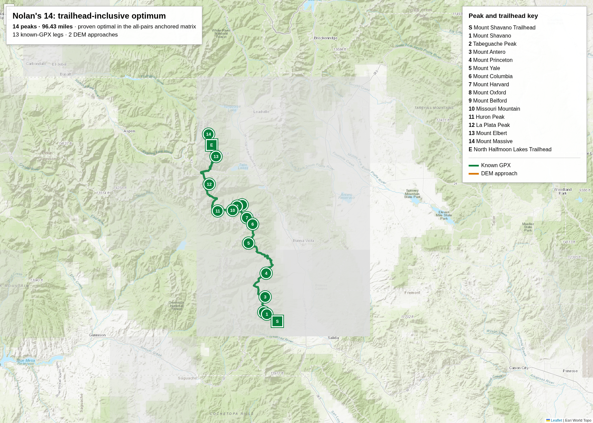

# PeakRouteFinder

PeakRouteFinder finds the largest number of peaks that fit within a mileage budget and proves that no route with more peaks exists. It uses an exact OR-Tools CP-SAT model, then minimizes mileage at that maximum peak count.

The original question was **Nolan's 14**: how many Colorado fourteeners could you climb in under 100 miles? The engine also accepts arbitrary peak lists and optional start and end trailheads.

## Nolan's 14 results

Two distance models answer different questions:

| Model | Budget | Peaks | Miles | Scope |
|---|---:|---:|---:|---|
| Straight-line haversine | 100 mi | **20** | **97.84** | Any 20 of Colorado's 53 fourteeners; no trailhead costs |
| GPX-anchored Valhalla+DEM | 100 mi | **14** | **96.43** | The standard Nolan's summits, including trailhead approaches |

The 20-peak result is a mathematical optimum for straight-line distances, not a feasible hiking route. It demonstrates the optimizer without claiming to solve Nolan's under real trail conditions.

The 14-peak result is the exact optimum for the GPX-anchored matrix. Its 13 summit-to-summit legs follow the known Nolan's GPX in standard order. Two DEM-modeled approaches connect Mount Shavano Trailhead and North Halfmoon Lakes Trailhead, bringing the total to **96.433290 miles**. No 15-peak route fits within 100 miles in that matrix. The approaches and matrix are not field-validated.



See the [Nolan's 14 routing POC](poc/valhalla/README.md) for the route, data provenance, model limits, and reproduction commands.

## Quick start

Python 3.11 or newer is required.

```bash
python3 -m venv .venv
source .venv/bin/activate
pip install -e '.[dev]'
pytest -q
python -m peakroutefinder data/colorado_14ers.csv --budget 100
```

The final command prints `PROVEN OPTIMAL`, the 20-peak route, its 97.84-mile total, each leg, and the complete visit order. This quick start uses haversine distance.

Add arbitrary trailheads with comma-separated latitude and longitude:

```bash
python -m peakroutefinder data/colorado_14ers.csv --budget 100 \
    --start "39.4718,-106.0975" --end "39.0046,-106.3706"
```

This example proves a 16-peak, 92.32-mile optimum. Omit `--end` for an open route beginning at the start waypoint. Omit both waypoints to optimize only the supplied peak list.

## Input and output

The input CSV must have exactly three columns and at least one peak:

```csv
Lat,Lon,Name
39.1178,-106.4454,Mount Elbert
39.1875,-106.4757,Mount Massive
```

Malformed rows, invalid coordinates, and empty files are rejected with the file name and line number. Duplicate names are allowed and are disambiguated by route position in the output.

```text
python -m peakroutefinder <list.csv> --budget MILES
    [--start LAT,LON] [--end LAT,LON]
    [--time-limit SECONDS] [--workers COUNT]
    [--out results.csv] [--map route.html]
```

`--time-limit` applies separately to each solve phase and defaults to 120 seconds. `--workers` defaults to the smaller of 16 and the available CPU count. `--out` writes `order,peak,leg_miles` rows and replaces an existing file.

Exit codes are 0 for success, 1 for usage or loading errors, 2 when either solve phase reaches its time limit, and 3 when no feasible route exists. A timeout reports the best route found and the proven peak-count bound without claiming optimality.

### Route maps

```bash
python -m peakroutefinder data/colorado_14ers.csv --budget 100 --map colorado-route.html
```

`--map` writes an interactive HTML map with an Esri WorldTopoMap basemap fitted to the input list. Every listed peak appears: visited peaks have name labels in route order, unvisited peaks are gray, and optional start/end waypoints are green/red. The key lists route peaks in order and includes a collapsible list of the other listed peaks. Hover over points for names and coordinates. The route line includes waypoint legs.

Open the HTML file in a browser. Internet access is required to load the Leaflet assets and Esri basemap tiles. These CLI maps draw straight-line haversine routes; they do not show the GPX/DEM geometry used by the Nolan's POC.

## Beyond Colorado's fourteeners

The same solver supports other lists and distance matrices. Detailed routes, maps, and reproduction commands live with each experiment.

| Experiment | Distance model | Budget | Proven maximum | Miles |
|---|---|---:|---:|---:|
| [Colorado top 100 13ers + 14ers](poc/colorado-centennial/README.md) | Haversine | 100 mi | **35 peaks** | **97.02** |
| [Colorado top 100 13ers + 14ers](poc/colorado-centennial/README.md) | GPX-anchored Valhalla+DEM | 100 mi | **27 peaks** | **99.85** |
| [Washington top 100](poc/washington/README.md) | Haversine | 60 mi | **27 peaks** | **57.50** |
| [Washington top 100](poc/washington/README.md) | Valhalla+DEM | 100 mi | **29 peaks** | **98.40** |

## How the proof works

Peaks and waypoints become nodes in a CP-SAT circuit. Each unvisited node takes a self-loop, while visited nodes form one path connected to a zero-cost dummy depot. Taken non-depot arcs contribute their integer milli-mile distances to the budget constraint.

The first phase maximizes the number of visited peaks. The second rebuilds the model, fixes that count, and minimizes total mileage. `PROVEN OPTIMAL` requires both phases to finish with CP-SAT status `OPTIMAL`.

The proof applies to the supplied distance matrix. It does not upgrade approximate or incomplete distances into a real-world feasibility claim.

## Why the optimizer is fast

Exact search is separate from distance acquisition, so CP-SAT operates on a numeric matrix rather than performing terrain or network work during the search.

| Optimization | Effect |
|---|---|
| CP-SAT circuit model | Uses OR-Tools' C++ engine instead of exhaustive DFS enumeration. |
| Precomputed distance matrix | Builds each matrix once and reuses it during both solve phases. |
| Two-phase objective | Proves the maximum peak count before minimizing mileage, avoiding weighted-objective tradeoffs. |
| Bounded parallel search | Uses integer milli-mile costs, up to 16 workers, and explicit time limits. |

The routing POCs add matrix caching, selective DEM routing, terminal connectors, and GPX anchoring. Their READMEs document those experiment-specific optimizations.

## Development status

| Phase | Scope | Status |
|---|---|---|
| Engine core | CLI, list loading, haversine matrix, exact two-phase solve | Implemented and verified |
| Real geometry | Valhalla, DEM, and GPX experiments behind the `DistanceProvider` seam | POCs complete; general provider integration remains |

The production CLI currently uses haversine distances. Real-geometry results remain POC-specific until unreachable arcs, provider-owned geometry, coverage limits, and trailhead selection are handled by a general provider.
