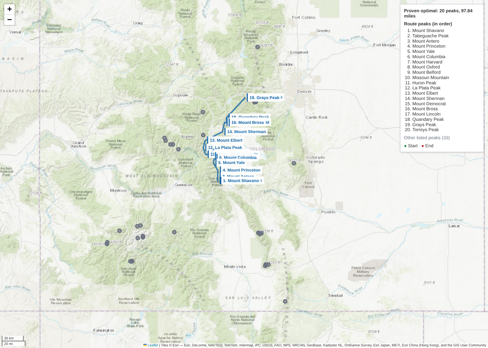

# Colorado 100-mile straight-line sample

Generated from the current optimizer with:

```bash
python -m peakroutefinder data/colorado_14ers.csv \
  --budget 100 \
  --out poc/colorado-100/route.csv \
  --map poc/colorado-100/route.html
```

Result: **20 peaks, 97.84 miles, proven optimal for the haversine distance matrix**.



- `route.txt`: complete console output and per-leg distances.
- `route.csv`: ordered peaks and leg distances.
- `route.html`: interactive map with peak-name labels and the route key.
- `route.png`: rendered map preview.

This is a geometric baseline, not a 100-mile trail route. The straight legs ignore trails, terrain, and trailhead approaches. The [Valhalla POC](../valhalla/README.md) evaluates the separate trail-routing problem.
