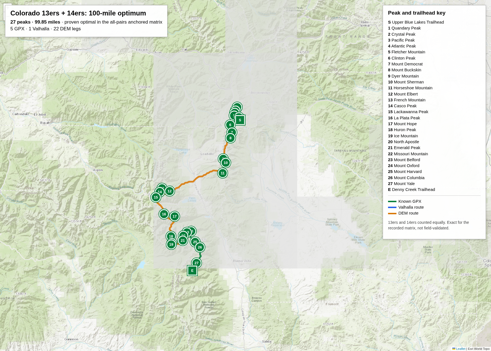
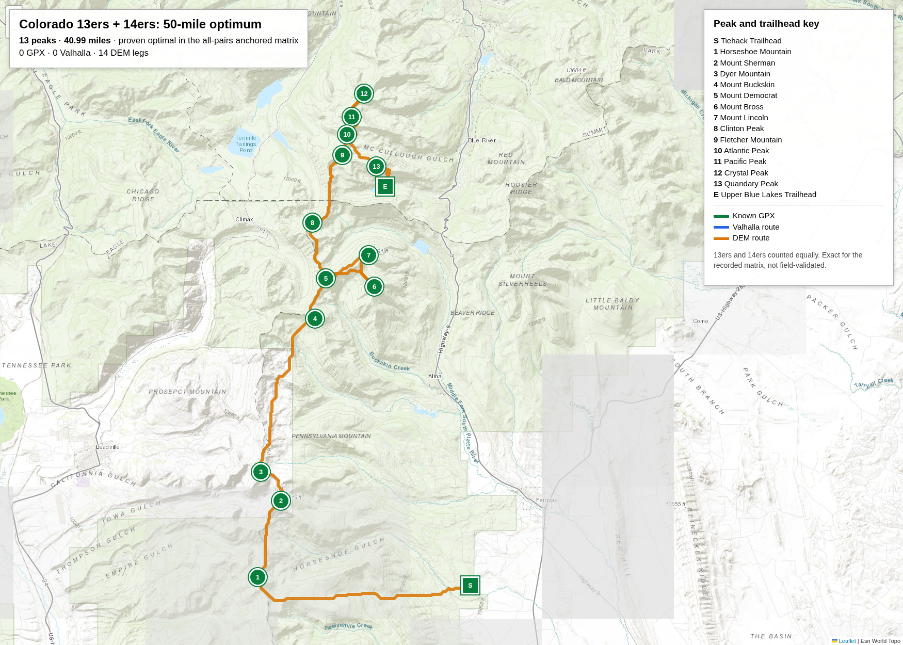
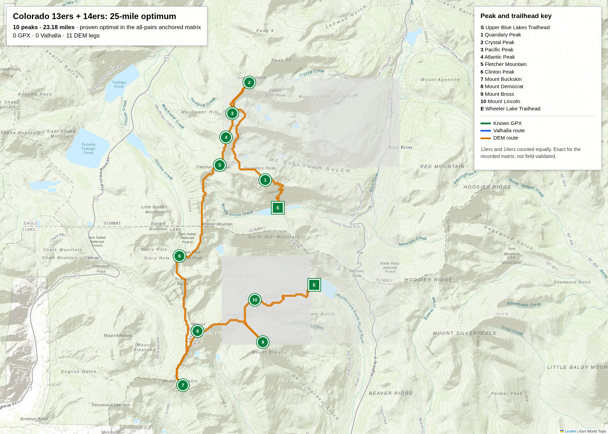

# Colorado top-100 13er/14er route optimization

`data/colorado_top100.csv` combines the existing 53 Colorado fourteeners with the 47 ranked thirteeners at Colorado ranks 54–100. Unranked subpeaks are excluded. The first 53 rows are unchanged from `data/colorado_14ers.csv`.

The thirteener names, ranks, elevations, and coordinates come from the [Climb13ers Centennial list](https://www.climb13ers.com/colorado-13ers/top-100). Coordinates are read from the list's embedded `GeoCoordinates` metadata and converted from degrees/minutes/seconds to decimal degrees. The source marks summit locations as not field-checked, so the input coordinates themselves are not a field-validated route survey.

The optimization counts thirteeners and fourteeners equally. It proves the maximum number of peaks within each budget and then minimizes mileage at that count. Nolan GPX overrides apply only to the 91 standard fourteener pairs; all other arcs use the Valhalla+DEM matrix. Trailhead approaches and returns are charged inside the budget.

## Optimal budget routes

All three solves returned `OPTIMAL` in both phases and proved that no route with more peaks exists within the budget. Every leg touches its exact summit or trailhead coordinates.

| Budget | Previous 14er-only maximum | Combined maximum | 13ers / 14ers | Miles | GPX / Valhalla / DEM legs |
|---:|---:|---:|---:|---:|---:|
| 100 mi | 14 | **27** | 15 / 12 | **99.845601** | 5 / 1 / 22 |
| 50 mi | 8 | **13** | 8 / 5 | **40.993639** | 0 / 0 / 14 |
| 25 mi | 5 | **10** | 6 / 4 | **23.175978** | 0 / 0 / 11 |



The 100-mile route runs from **Upper Blue Lakes Trailhead to Denny Creek Trailhead** through Quandary, Crystal, Pacific, Atlantic, Fletcher, Clinton, Democrat, Buckskin, Dyer, Sherman, Horseshoe, Elbert, French, Casco, Lackawanna, La Plata, Hope, Huron, Ice, North Apostle, Emerald, Missouri, Belford, Oxford, Harvard, Columbia, and Yale.



The 50-mile route runs from **Tiehack Trailhead to Upper Blue Lakes Trailhead** through Horseshoe, Sherman, Dyer, Buckskin, Democrat, Bross, Lincoln, Clinton, Fletcher, Atlantic, Pacific, Crystal, and Quandary. All 14 legs are DEM-based.



The 25-mile route runs from **Upper Blue Lakes Trailhead to Wheeler Lake Trailhead** through Quandary, Crystal, Pacific, Atlantic, Fletcher, Clinton, Buckskin, Democrat, Bross, and Lincoln. All 11 legs are DEM-based.

The 50- and 25-mile optima therefore have no known-GPX coverage. They are exact matrix optima, not field-validated routes. Basemaps use Esri World Topo.

## Reproduction

Start the existing pinned Colorado router:

```bash
poc/valhalla/run_valhalla.sh
```

Wait for `Starting valhalla service!`, then build the 100-by-100 exact-endpoint matrix:

```bash
python -m peakroutefinder.poc.optimize \
  --peaks data/colorado_top100.csv \
  --budget 100 \
  --dem-cache /tmp/peakroutefinder-valhalla/dem-tiles \
  --output-dir /tmp/peakroutefinder-valhalla/colorado-top100-optimize
```

Solve the trailhead-inclusive 100-mile route with the known Nolan GPX anchors:

```bash
python -m peakroutefinder.poc.trailheads \
  --peaks data/colorado_top100.csv \
  --pbf /tmp/peakroutefinder-valhalla/custom_files/colorado-261124.osm.pbf \
  --matrix /tmp/peakroutefinder-valhalla/colorado-top100-optimize/matrix.json \
  --reference-gpx /tmp/peakroutefinder-valhalla/nolans-fkt.gpx \
  --dem-cache /tmp/peakroutefinder-valhalla/dem-tiles \
  --budget 100 \
  --output-dir /tmp/peakroutefinder-valhalla/colorado-top100-trailheads-100
```

Repeat the trailhead command with `--budget 50` and `--budget 25`, using separate output directories. A result is reported as proven only when both CP-SAT phases return `OPTIMAL`.

The recorded matrix attempted DEM A* for 872 short-range directed candidates and selected terrain paths for 827 cells where DEM beat Valhalla. Before trailhead costs, the 100-mile peak-only solve proved a 29-peak, 96.30-mile optimum.
