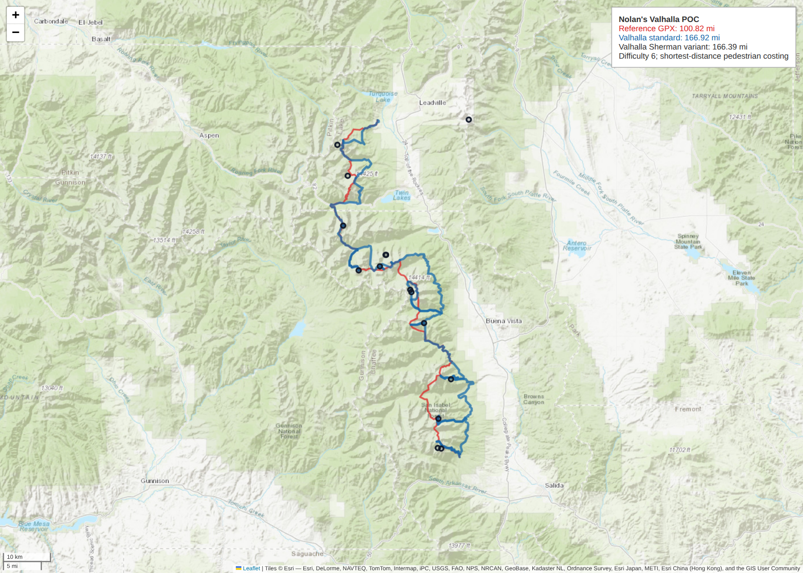
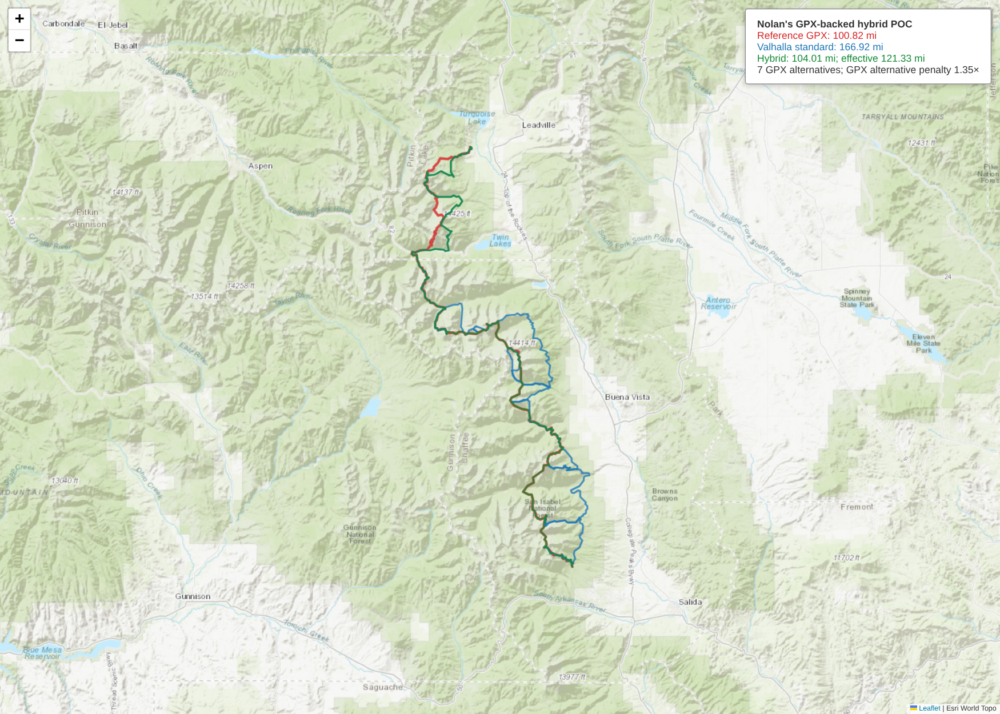
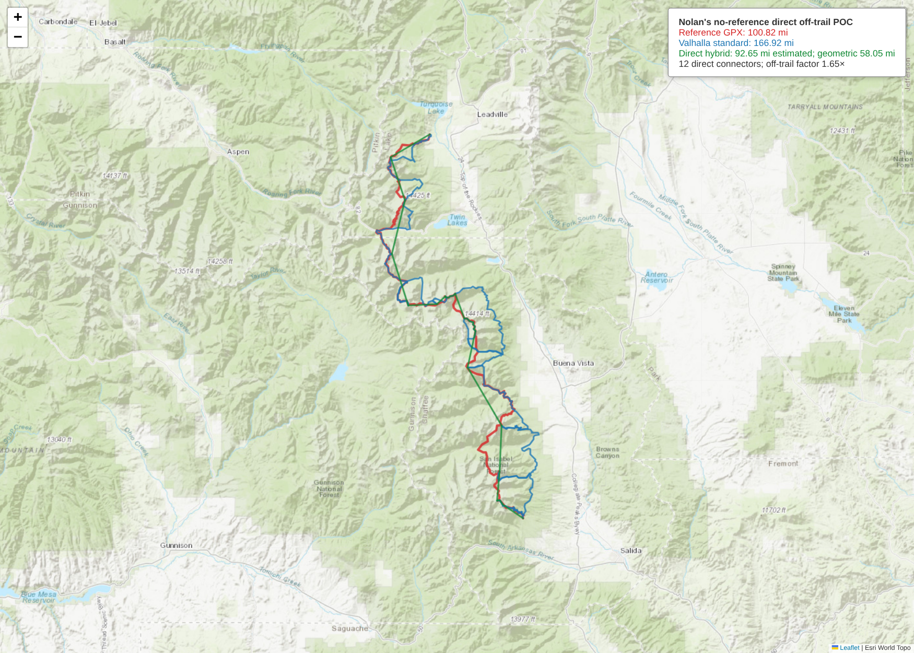
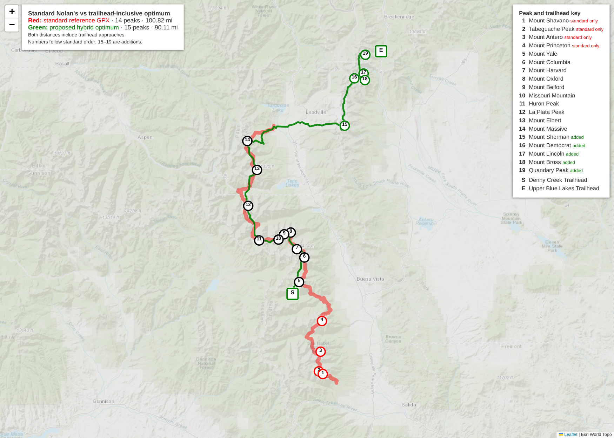

# Nolan's 14 Valhalla proof of concept

This POC checks whether a local Valhalla pedestrian router can reproduce Nolan's trail distances and geometry before we integrate it with the CP-SAT optimizer. It routes each connector independently, so no failed leg is hidden by an otherwise successful request.

## Reproduce

Requirements: Docker, curl, and the project's Python environment.

Start Valhalla in one terminal:

```bash
poc/valhalla/run_valhalla.sh
```

The launcher downloads the pinned Colorado extract on its first run, verifies its SHA-256, builds tiles, and listens on `127.0.0.1:18002`. Tile files remain under `/tmp/peakroutefinder-valhalla/custom_files`. Set `VALHALLA_PORT` or `VALHALLA_THREADS` to override those defaults.

Download the public reference GPX in another terminal:

```bash
curl -fL \
  https://fastestknowntime.com/system/files/routes/gps_data/export_11.gpx \
  -o /tmp/peakroutefinder-valhalla/nolans-fkt.gpx
```

Run the standard, Sherman-variant, GPX-backed hybrid, direct-hybrid, and DEM-aware hybrid sequences:

```bash
.venv/bin/python -m peakroutefinder.poc.nolans \
  --reference-gpx /tmp/peakroutefinder-valhalla/nolans-fkt.gpx \
  --output-dir /tmp/peakroutefinder-valhalla/results
```

Outputs:

- `results.json`: configuration, snapping, leg distances, hiking effort, elevation gain, errors, connector provenance, and decoded geometry.
- `routes.geojson`: the reference track, successful Valhalla legs, and selected hybrid/DEM terrain paths for visual comparison.

The GPX comes from the [Fastest Known Time Nolan's route page](https://fastestknowntime.com/route/nolans-14-co). Its redistribution license is not stated, so it is downloaded rather than committed.

Elevation comes from [Mapzen Terrain Tiles](https://github.com/tilezen/joerd) in Terrarium encoding, cached under `/tmp/peakroutefinder-valhalla/dem-tiles`. The DEM is routing input only; no reference GPX coordinates enter A* candidate construction.

## Frozen inputs and routing configuration

| Input | Identity |
|---|---|
| Valhalla | 3.9.3, image digest `sha256:d438516425e785442562852d2f38d048478b6895bb15850491b81332f85bc4be` |
| OSM | Geofabrik `colorado-261124.osm.pbf` |
| OSM SHA-256 | `90e8c15e77665205f8090fd8dd3aae0a13bc97d961819e7b41d291a1d6541347` |
| Reference GPX SHA-256 | `3af279e155f69036a82f3d33521663693385cddf8ac4fed3091699cfd828f90c` |
| Costing | `pedestrian`, `shortest=true`, `use_hills=1` |
| Hiking difficulty | 6, the most permissive `sac_scale` setting; this is a coverage POC, not a safety recommendation |
| Maximum route distance | 250,000 meters, explicitly above Valhalla's 100,000-meter default |
| GPX alternative penalty | 1.35× for candidate selection only; actual GPX mileage is still reported |
| Direct off-trail factor | 1.65× direct haversine miles, rounded from the GPX per-leg median of 1.643 |
| DEM | Terrarium zoom 12, 8-neighbor A*, 2-pixel stride, 48-pixel boundary padding |
| DEM validity | Reject non-finite, below -1,000 m, or above 9,000 m tile values |
| Off-trail effort | Tobler hiking speed converted to flat-equivalent miles at 3.1 mph |

## Results

The reference GPX contains 146,806 track points and measures **100.82 miles** using the project's haversine constant. It runs from Blank Gulch to Fish Hatchery and passes within 0.007 miles of every standard Nolan's summit.

Valhalla returned geometry for every requested leg. No leg failed, but many returned long loops around missing or excluded off-trail connections.

| Route | Distance | Reference | Difference |
|---|---:|---:|---:|
| Standard Nolan's, Blank Gulch to Fish Hatchery | 166.92 mi | 100.82 mi | +66.10 mi (+65.6%) |
| GPX-backed hybrid, same endpoints | 104.01 mi | 100.82 mi | +3.19 mi (+3.2%) |
| No-reference direct hybrid, same endpoints | 92.65 mi estimated | 100.82 mi | -8.17 mi (-8.1%) |
| DEM-aware hybrid, same endpoints | 91.07 path mi | 100.82 mi | -9.75 mi (-9.7%) |
| Sherman-to-Shavano variant, summit to summit | 166.39 mi | No matching GPX | Not compared |

The hybrid selects each GPX leg when `GPX miles × 1.35 < Valhalla miles`, or when Valhalla fails. It uses **7 GPX alternatives**, retains Valhalla on 8 legs, and has **121.33 penalty-weighted miles**. Actual mileage remains the geometric distance of the selected path; the penalty affects only selection. The `gpx-alternative` source explicitly denotes whole-leg reference geometry; no segment-level off-trail classification is claimed.

The no-reference direct hybrid constructs candidates only from waypoint coordinates and Valhalla results. It estimates each direct connector as `haversine miles × 1.65` and selects it when that estimate beats Valhalla, or when Valhalla fails. It uses **12 direct connectors**, retains Valhalla on Shavano-to-Tabeguache, Columbia-to-Harvard, and Oxford-to-Belford, and reports **92.65 estimated miles**. Its raw geometric total is **58.05 miles**. The GPX is used only to calibrate and score this heuristic, never to construct its candidates.

The DEM-aware hybrid replaces straight candidates with A* terrain paths. Selection uses slope-aware hiking effort; reported path miles measure the selected terrain geometry, and elevation gain is exported separately. It selects **8 DEM connectors**, totals **91.07 path miles** and **130.52 effort miles**, and retains Valhalla on the other 7 legs. Harvard-to-Oxford, for example, becomes a 4.34-mile terrain path with 2,821 feet of gain and 9.34 effort miles instead of a 24.29-mile Valhalla detour. DEM failures make the route incomplete; they never trigger a straight-line fallback.

The Sherman variant uses Sherman, Elbert, La Plata, Huron, Missouri, Belford, Oxford, Harvard, Columbia, Yale, Princeton, Antero, Tabeguache, and Shavano. It excludes trailhead approaches because its reference trailheads were not supplied.



Red is the 100.82-mile reference GPX; blue shows the 166.92-mile standard and 166.39-mile Sherman-variant Valhalla routes.



Green is the 104.01-mile hybrid, blue is the standard Valhalla route, and red is the reference GPX.



Green is the 92.65-mile estimated direct hybrid, blue is the standard Valhalla route, and red is the reference GPX. Straight green segments are candidate connectors, not terrain-derived walking paths.

### Standard-route legs

| Leg | Valhalla | GPX | Hybrid | Hybrid source |
|---|---:|---:|---:|---|
| Start (Blank Gulch) → Mount Shavano | 4.78 | 4.24 | 4.78 | Valhalla |
| Mount Shavano → Tabeguache Peak | 0.92 | 1.01 | 0.92 | Valhalla |
| Tabeguache Peak → Mount Antero | 17.87 | 4.62 | 4.62 | GPX-backed |
| Mount Antero → Mount Princeton | 21.62 | 10.87 | 10.88 | GPX-backed |
| Mount Princeton → Mount Yale | 20.23 | 14.94 | 14.94 | GPX-backed |
| Mount Yale → Mount Columbia | 12.36 | 6.50 | 6.50 | GPX-backed |
| Mount Columbia → Mount Harvard | 2.47 | 3.10 | 2.47 | Valhalla |
| Mount Harvard → Mount Oxford | 24.29 | 4.74 | 4.74 | GPX-backed |
| Mount Oxford → Mount Belford | 1.42 | 1.59 | 1.42 | Valhalla |
| Mount Belford → Missouri Mountain | 3.34 | 2.23 | 2.23 | GPX-backed |
| Missouri Mountain → Huron Peak | 12.69 | 5.57 | 5.57 | GPX-backed |
| Huron Peak → La Plata Peak | 10.95 | 12.22 | 10.95 | Valhalla |
| La Plata Peak → Mount Elbert | 13.88 | 13.11 | 13.88 | Valhalla |
| Mount Elbert → Mount Massive | 11.34 | 9.08 | 11.34 | Valhalla |
| Mount Massive → End (Fish Hatchery) | 8.75 | 7.00 | 8.75 | Valhalla |

All distances are miles. GPX leg distances include GPS noise and describe one public route line, not the only valid Nolan's line.

### Snapping and geometry

Valhalla snapped every input to a pedestrian edge, but several summits are far from the nearest routable edge. Mount Oxford's nearest reported snap is 3,139.8 meters away; Mount Yale is 2,786.3 meters and Mount Princeton is 2,343.7 meters. The two supplied trailheads snap within 25 meters.

The returned shapes begin and end at the input coordinates and include straight off-network connectors to snapped edges. Consequently, a successful response is not proof that a continuous mapped trail exists. Snap distances and path shape must be part of any production coverage report.

These connectors are included in Valhalla's reported distance. On the checked Columbia-to-Harvard leg, the decoded geometry measures 2.471967 miles and the summary reports 2.474700 miles, a rounding-level difference. Its shorter distance than the GPX represents a different, more direct line, not omitted connector mileage.

## Verdict and next step

**Valhalla is a suitable routing API, but unmodified OSM is not a valid Nolan's distance matrix.** Using the stock matrix in CP-SAT would prove optimality for large detours, not for the Nolan's route. The GPX-backed hybrid reduces the gap to 3.19 miles, but it is anchored to one known line. The direct and DEM hybrids remove that runtime dependency; the DEM version produces actual terrain-path geometry and 91.07 path miles, but neither establishes a general trail-distance provider.

The next POC should map-match the reference GPX with `trace_attributes`, evaluate DEM routing against additional independent GPX tracks, and add explicit slope or land-cover safety constraints. DEM resolution and hiking-cost calibration remain error sources. Until then, do not integrate any hybrid matrix into the general optimizer or label its output trail-optimal.

## All-peak hybrid optimization

With the local Valhalla service running, optimize the full Colorado list through the existing CP-SAT engine:

```bash
python -m peakroutefinder.poc.optimize \
  --budget 100 \
  --output-dir /tmp/peakroutefinder-valhalla/optimize-100-exact
```

The provider queries Valhalla for pairs within 100 straight-line miles and evaluates directed DEM alternatives for pairs within 15 miles. Farther pairs retain haversine, and unavailable Valhalla pairs receive the router's 124.27-mile over-limit lower bound; neither can create a false route within a 100-mile budget. Budgets above 100 miles are rejected because these lower bounds are not actual distances. Each arc selects the lower of actual Valhalla and DEM path miles, not hiking-effort miles. DEM coverage beyond 15 miles is not evaluated, so optimality applies to this bounded hybrid matrix rather than every possible terrain path.

`matrix.json` caches each DEM candidate and supports resuming an interrupted run. `result.json` records the solver status, peak bound, route, mileage, and selected leg geometry.

### Results

All listed solves reached `OPTIMAL` in both CP-SAT phases. Mileage is the cheapest route at the proven maximum peak count for this matrix.

| Budget | Proven maximum fourteeners | Cheapest maximum-count route |
|---:|---:|---:|
| 90 mi | 15 | 85.26 mi |
| 100 mi | **17** | **97.29 mi** |
| 105 mi | 18 | 102.99 mi |
| 110 mi | 19 | 109.15 mi |
| 120 mi | 19 | 109.15 mi |

At 100 miles, the exact upper bound is **17 peaks**: this matrix contains no 18-peak route, and therefore no route beating the haversine model's 20-peak result. The 100-mile route is Shavano → Tabeguache → Antero → Princeton → Yale → Columbia → Harvard → Oxford → Belford → Missouri → Huron → La Plata → Elbert → Sherman → Democrat → Lincoln → Bross. It uses 12 DEM legs and 4 Valhalla legs. Every reported leg uses its exact matrix mileage and sums to 97.285 miles; separate Valhalla route calls supply geometry only.

An 18th peak becomes possible at 102.99 miles by adding Massive; a 19th becomes possible at 109.15 miles by adding Quandary. The maximum remains 19 at 120 miles. These are matrix results, not proof that no real-world terrain route exists beyond the evaluated DEM cutoff.

## Trailhead-inclusive optimization

After building the peak matrix, run the terminal-aware optimizer with the same local Valhalla and DEM data:

```bash
python -m peakroutefinder.poc.trailheads \
  --budget 100 \
  --output-dir /tmp/peakroutefinder-valhalla/trailheads-100-exact
```

The POC reads every `highway=trailhead` node from the pinned Colorado OSM PBF, preserves its OSM ID, and assigns each peak its nearest trailhead by haversine distance. For every possible first and last peak, directed approach and return connectors use the shorter actual path from Valhalla or DEM. CP-SAT charges those connectors on its depot arcs, so the 100-mile budget includes getting from a trailhead to the first summit and from the last summit to a trailhead. The solver chooses the endpoints and summit order jointly rather than attaching approaches to the prior answer.

Valhalla can snap an input summit or trailhead to a nearby mapped edge. Every Valhalla matrix arc and returned leg therefore includes straight haversine connectors from the exact input coordinates to those snapped endpoints. The geometry includes the same connectors, and DEM paths already start and end at the exact coordinates.

### 100-mile result

CP-SAT proved a maximum of **15 peaks** with a cheapest maximum-count route of **90.126929 miles**. No 16-peak route fits within 100 miles under this terminal-cost model. Every one of the 32 leg endpoints exactly equals its summit or trailhead input coordinate.

The route starts at **Denny Creek Trailhead**, visits Yale → Columbia → Harvard → Oxford → Belford → Missouri → Huron → La Plata → Elbert → Massive → Sherman → Democrat → Bross → Lincoln → Quandary, and ends at **Upper Blue Lakes Trailhead**. The opening Denny Creek→Yale connector is 3.124 miles and the closing Quandary→Upper Blue Lakes connector is 1.738 miles. The complete 16-leg route uses 14 DEM connectors and 2 Valhalla connectors; all 106 candidate terminal connectors succeeded without DEM errors.



Red is the standard 14-peak reference GPX (100.82 miles); green is the trailhead-inclusive 15-peak optimum (90.13 miles). Both totals include approaches. Numbers follow the standard sequence, with 15–19 marking optimizer additions. The key identifies Shavano, Tabeguache, Antero, and Princeton as standard-only, and labels the selected start (S) and end (E) trailheads.

This model uses the nearest tagged OSM trailhead, not necessarily the standard or safest access for a summit. Unmapped trailheads and OSM tagging gaps remain data limitations. Optimality applies to those nearest-trailhead choices and the bounded hybrid matrix.

### Known-GPX-anchored result

To ground the standard Nolan's transitions in the known route, pass the reference GPX and the exact-endpoint matrix:

```bash
python -m peakroutefinder.poc.trailheads \
  --matrix /tmp/peakroutefinder-valhalla/optimize-100-exact/matrix.json \
  --reference-gpx /tmp/peakroutefinder-valhalla/nolans-fkt.gpx \
  --budget 100 \
  --output-dir /tmp/peakroutefinder-valhalla/trailheads-100-gpx-all-pairs
```

This replaces both directions of all **91 standard summit pairs** with cumulative GPX mileage and geometry, including exact-summit snap connectors and every intermediate summit section. Non-standard arcs and terminal connectors remain from the exact hybrid model. The all-pairs solve proves a maximum of **14 peaks** and **96.433290 miles**; no 15-peak route fits within 100 miles in this model.

The optimal order is **Mount Shavano Trailhead → Shavano → Tabeguache → Antero → Princeton → Yale → Columbia → Harvard → Oxford → Belford → Missouri → Huron → La Plata → Elbert → Massive → North Halfmoon Lakes Trailhead**. These are exactly the standard 14 Nolan's summits in standard order. All 13 summit-to-summit legs use the known GPX and total 89.638460 miles. The only non-GPX legs are Mount Shavano Trailhead→Shavano (3.606354 miles) and Massive→North Halfmoon Lakes Trailhead (3.188476 miles). All 30 leg endpoints exactly equal their summit or trailhead coordinates.

The 14-peak bound is exact for this all-pairs anchored matrix. Unlike the adjacent-only result, no unanchored summit-to-summit connector remains in the winning route. Real-world feasibility of the two nearest-trailhead approaches still depends on the DEM model and OSM trailhead tagging.
