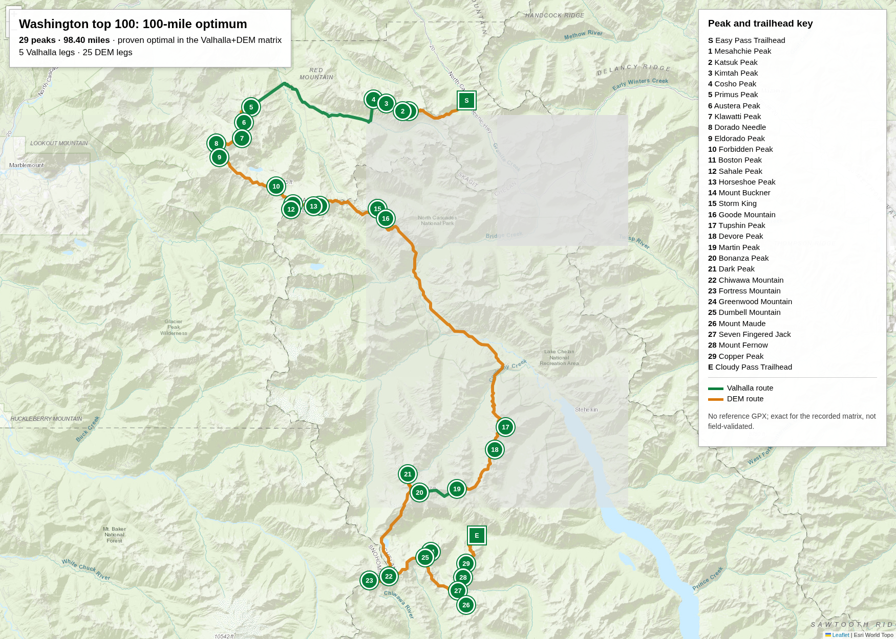
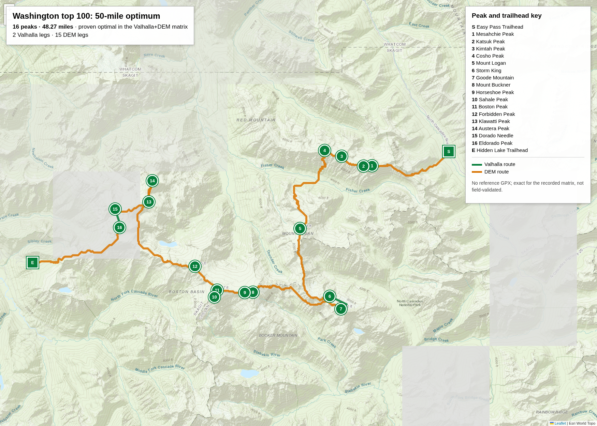
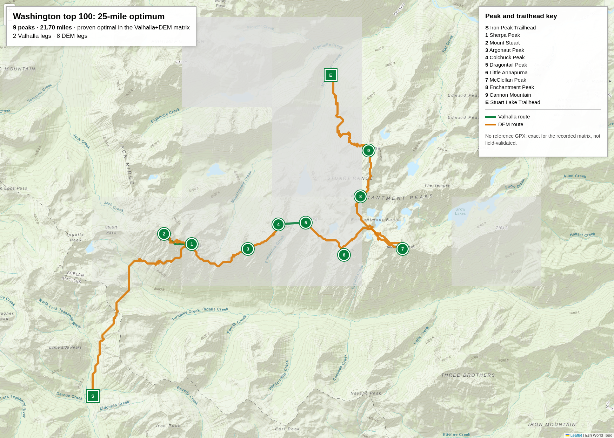

# Washington top-100 route optimization

This proof of concept applies the existing exact CP-SAT orienteering solver to `data/washington_top100.csv`. It uses all 100 rows, whose bounds are 46.1914178–48.997601° N and 122.195606–119.97057° W.

Unlike the Nolan results, Washington has no reference GPX input. Distances come from the existing all-pairs Valhalla+DEM model: Valhalla supplies the directed matrix, and short-range candidates use terrain-aware DEM routes when available. Trailhead approaches and returns are charged inside the mileage budget. These are exact optima for the recorded matrix, not known-GPX-validated field routes.

## Optimal budget routes

All three solves returned `OPTIMAL` in both phases and proved that one additional peak cannot fit the budget. Every leg touches the exact summit or trailhead coordinates.

| Budget | Proven maximum peaks | Cheapest maximum-count route | Valhalla legs | DEM legs |
|---:|---:|---:|---:|---:|
| 100 mi | **29** | **98.398107 mi** | 5 | 25 |
| 50 mi | **16** | **48.267373 mi** | 2 | 15 |
| 25 mi | **9** | **21.700145 mi** | 2 | 8 |



The 100-mile route runs from **Easy Pass Trailhead to Cloudy Pass Trailhead** through Mesahchie, Katsuk, Kimtah, Cosho, Primus, Austera, Klawatti, Dorado Needle, Eldorado, Forbidden, Boston, Sahale, Horseshoe, Buckner, Storm King, Goode, Tupshin, Devore, Martin, Bonanza, Dark, Chiwawa, Fortress, Greenwood, Dumbell, Maude, Seven Fingered Jack, Fernow, and Copper.



The 50-mile route runs from **Easy Pass Trailhead to Hidden Lake Trailhead** through Mesahchie, Katsuk, Kimtah, Cosho, Logan, Storm King, Goode, Buckner, Horseshoe, Sahale, Boston, Forbidden, Klawatti, Austera, Dorado Needle, and Eldorado.



The 25-mile route runs from **Iron Peak Trailhead to Stuart Lake Trailhead** through Sherpa, Stuart, Argonaut, Colchuck, Dragontail, Little Annapurna, McClellan, Enchantment, and Cannon.

## Reproduction

Start the pinned Valhalla image. The launcher downloads the Washington OSM extract when absent and verifies its SHA-256 before starting:

```bash
poc/washington/run_valhalla.sh
# PBF SHA-256: 13c40f966d3adb0fc31041600221257ac0e87db3f4972a6057b9f8edfd7292cf
```

The first launch builds routing tiles; wait for `Starting valhalla service!` before sending requests. Build the exact-endpoint hybrid matrix and the initial 100-mile peak-only result:

```bash
python -m peakroutefinder.poc.optimize \
  --peaks data/washington_top100.csv \
  --budget 100 \
  --dem-cache /tmp/peakroutefinder-washington/dem-tiles \
  --output-dir /tmp/peakroutefinder-washington/optimize-100-exact
```

Add nearest-OSM-trailhead approaches and returns, then solve the trailhead-inclusive 100-mile route:

```bash
python -m peakroutefinder.poc.trailheads \
  --peaks data/washington_top100.csv \
  --pbf /tmp/peakroutefinder-washington/custom_files/washington-latest.osm.pbf \
  --matrix /tmp/peakroutefinder-washington/optimize-100-exact/matrix.json \
  --dem-cache /tmp/peakroutefinder-washington/dem-tiles \
  --budget 100 \
  --output-dir /tmp/peakroutefinder-washington/trailheads-100
```

Repeat the trailhead command with `--budget 50` and `--budget 25`, using separate output directories. Each budget uses two CP-SAT phases: prove the maximum peak count, then minimize mileage at that fixed count. A result is reported as proven only when both phases return `OPTIMAL`.

The recorded 100-by-100 matrix attempted DEM A* for 1,464 short-range directed candidates and produced 1,408 terrain connectors; Valhalla covered the remaining candidates. The peak-only 100-mile solve proved a 32-peak, 97.27-mile optimum before trailhead costs.

Basemaps in the route images use Esri World Topo.
